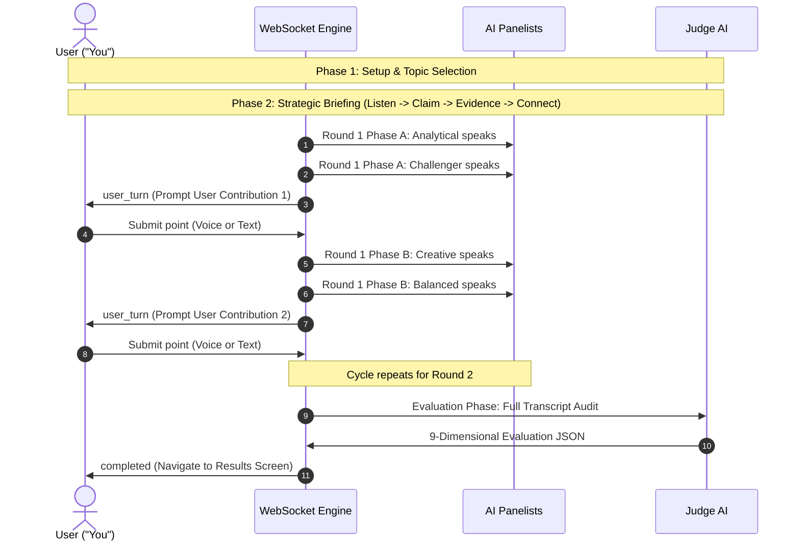

# GD Arena — Project Context & System Specification

> **Notice for AI Assistants (ChatGPT, Claude, Gemini, etc.):**
> This file is the single source of truth for **GD Arena**. Read this document completely to understand the project architecture, design philosophy, code conventions, state machines, and completed milestones before answering questions, generating code, or planning new features.

---

## 1. Project Overview & Core Mission

**GD Arena** is an AI-powered, real-time Group Discussion (GD) simulator built to bridge the gap between theoretical communication knowledge and high-pressure interview performance. 

Group discussions are a primary screening stage for MBA admissions, management consulting, product management, and corporate leadership roles. Most candidates struggle with "blank-mind syndrome," interrupting gracefully, synthesizing opposing viewpoints, or structuring arguments under tight time constraints.

### The Solution
GD Arena places the human user at a simulated round table with **four distinct AI panelists** and an **autonomous AI Judge**. 
- The AI panelists simulate realistic peer dynamics: some demand hard data, some aggressively challenge premises, others introduce creative paradigms, and one attempts to synthesize consensus.
- The user speaks or types in turn-based rounds.
- Once completed, the **Judge AI** performs a multidimensional audit across 9 analytical and communication criteria, providing a comprehensive score card, radar breakdown, and concrete behavioral recommendations.

---

## 2. Technology Stack & Runtime Architecture

```text
┌─────────────────────────────────────────────────────────────────────────────┐
│                             CLIENT (BROWSER)                                │
│  Next.js 14 (App Router) · React 18 · TypeScript · Tailwind CSS             │
│  Framer Motion · Recharts · HTML5 MediaRecorder & Web Speech API            │
└───────────────────────▲─────────────────────────────▲───────────────────────┘
                        │ HTTP / JSON                 │ WebSocket (ws://)
                        ▼                             ▼
┌─────────────────────────────────────────────────────────────────────────────┐
│                           BACKEND (FASTAPI)                                 │
│  FastAPI (Python 3.13) · Uvicorn · Pydantic v2 · Python-Jose (JWT)          │
│  Deterministic Turn Engine · Prompt Orchestration                           │
└───────────────────────▲─────────────────────────────▲───────────────────────┘
                        │                             │
                        ▼                             ▼
┌───────────────────────────────────┐     ┌───────────────────────────────────┐
│     INTELLIGENCE (GOOGLE GEMINI)  │     │      PERSISTENCE (MONGODB)        │
│  google-genai SDK                 │     │  PyMongo (Cloud or Local)         │
│  Gemini 3.5 Flash Lite / 3.8      │     │  Automatic fallback to in-memory  │
│  Multimodal Audio Transcription   │     │  repository if DB unreachable     │
└───────────────────────────────────┘     └───────────────────────────────────┘
```

### Frontend Stack
- **Framework:** Next.js 14 (App Router), React 18, TypeScript.
- **Styling:** Vanilla Tailwind CSS with custom light/multi-color design tokens in `globals.css`.
- **Animations:** Framer Motion (page transitions, spring overlays, soundwaves, interactive persona cards).
- **Analytics Visualization:** Recharts (Radar charts, score bars, dimensional breakdowns).
- **Audio Capture:** HTML5 `MediaRecorder` (Opus/WebM/MP4) + Web Speech API fallback.
- **Icons:** `lucide-react`.

### Backend Stack
- **Framework:** FastAPI (Python), asynchronous route handlers and WebSocket endpoints.
- **Runtime Server:** Uvicorn with `--reload` support.
- **Data Validation:** Pydantic v2 schemas (`User`, `Discussion`, `Message`, `Evaluation`).
- **Authentication:** Salted PBKDF2 password hashing + HTTP-only JWT cookies (`gd_token`).
- **Intelligence Layer:** `google-genai` SDK targeting Gemini 3.5 Flash Lite / Gemini 3.8 Flash.
- **Audio Transcription:** Multi-model audio ingestion endpoint `/api/speech/transcribe`.
- **Database:** MongoDB via PyMongo with graceful fallback to thread-safe in-memory storage.

---

## 3. The Multi-Agent Ecosystem & Personas

The arena features five active roles (4 AI panelists + 1 human user), supervised by 1 non-participating evaluator (Judge AI).

### AI Panelist Personas (`backend/agents/participants.py`)

| Name | Role Title | Core Strategy & Behavior | Accent Color |
| :--- | :--- | :--- | :--- |
| **Analytical** | Data-Driven Analyst | Grounds arguments with concrete metrics, ROI, trade-offs, and cause-and-effect data. Prevents vague hand-waving. | Blue (`#2563eb`) |
| **Challenger** | Devil's Advocate & Risk Evaluator | Pressure-tests consensus. Respectfully identifies unstated assumptions, risks, edge cases, and contrarian perspectives. | Rose / Coral (`#e11d48`) |
| **Creative** | Innovation Strategist & Lateral Thinker | Unlocks unexpected lateral frameworks, cross-industry analogies, futuristic models, and experimental alternatives. | Amber / Gold (`#d97706`) |
| **Balanced** | Strategic Synthesizer & Consensus Builder | Connects fragmented viewpoints, resolves disputes, finds common ground, and drives the room toward actionable synthesis. | Violet / Purple (`#7c3aed`) |

### Role-Aware Panelist Architecture
All four AI panelists dynamically adapt their vocabulary, frameworks, and evaluation criteria based on the active session configuration:
- **`target_role` (`category`):** Automatically injects domain-specific knowledge and priorities (e.g., Product Management focuses on user friction, RICE prioritization, and adoption/retention metrics; Consulting emphasizes MECE structuring, hypothesis testing, and cost-benefit trade-offs; Technology focuses on scalability, SLAs, and technical debt; Sales focuses on qualification, value propositions, and objection handling).
- **`candidate_level` (`difficulty`):** Calibrates the probing depth from Junior/Entry-Level (accessible, foundational questions) to Mid-Level (structured trade-off justification) and Senior/Executive (rigorous scrutiny on second-order system dynamics and hidden risks).
- **`panelist_objective` & `other_panelists`:** Informs each persona of their unique tactical goal and how their peers are positioned around the table, fostering realistic, organic discussion dynamics.

### Execution Modes
1. **Live Mode (LLM Enabled - `GEMINI_API_KEY` present):**
   - Each persona uses the structured role-aware system prompt to evaluate recent conversation history and generate 2-3 concise, in-character contributions directly engaging peer and candidate arguments.
2. **Demo Mode (Fallback when no key is set):**
   - Personas draw from dynamic, role-interpolated response templates that anchor back to the chosen category and topic, ensuring authentic demonstrations without an external API key.

---

## 4. The Discussion Lifecycle & Turn Engine

The live discussion follows a structured, deterministic turn-engine implemented over WebSockets in `backend/app/main.py`.



### WebSocket Message Protocol (`/ws/discussions/{session_id}`)
- Server to Client:
  - `{"type": "session", "topic": "...", "participants": [...]}`
  - `{"type": "thinking", "speaker": "Analytical"}`
  - `{"type": "message", "message": {"speaker": "...", "role": "...", "content": "...", "round": 1}}`
  - `{"type": "user_turn", "round": 1}`
  - `{"type": "completed", "evaluation": {...}}`
  - `{"type": "error", "message": "..."}`
- Client to Server:
  - `{"content": "User's argument or synthesis..."}`
  - `{"action": "reading_done"}` (Sent when user finishes reading an AI contribution or 60s timer expires)

### 4.1 AI Participant 60-Second Reading Pop-Up & Main Timer Pausing
To prevent rapid-fire AI responses from overwhelming the user and to eliminate text truncation:
1. **Automatic Pop-Up:** As soon as an AI participant produces a thought/answer, it automatically pops up in a dedicated modal displaying their avatar, role title, round tag, persona color accents, and the **full, untruncated message**.
2. **Main Timer Freezing:** While the pop-up is active, the main session timer (e.g., 8:00 countdown) is **completely frozen** (with a visible `[PAUSED]` indicator in the top control bar). The user's discussion duration is never penalized while reading.
3. **60-Second Reading Countdown:** The pop-up features a visible 60s countdown timer with a live depleting progress bar.
4. **Advance on Completion or Early Click:** 
   - When the 60 seconds expire, the pop-up automatically closes, the main timer resumes, and `{ action: "reading_done" }` is sent.
   - If the user finishes reading earlier, they can click the **"Continue Discussion ({seconds}s)"** button to immediately dismiss the pop-up and resume.
   - The backend pauses with `wait_for_reading_ack` after each agent response, guaranteeing smooth turn transitions.

---

## 5. Voice & Speech-to-Text Architecture (Speak-to-Stop)

To simulate speaking in real interviews without requiring continuous keyboard input, GD Arena provides an end-to-end voice workflow:

### User Experience:
1. When it is the user's turn, they can click the **"Speak"** button (or type manually).
2. The button transforms into a prominent **"Stop"** button with a square stop icon and recording styling.
3. **Uninterrupted Speech Period:** From clicking **Speak** to clicking **Stop**, the user can speak freely for as long as they need. There are **no premature silence cutoffs**; the user retains full control.
4. **Auto-Transcribe & Auto-Send on Stop:**
   - Once the user clicks **Stop**, the client immediately stops the recording.
   - The button switches to a **"Transcribing..."** state.
   - The audio chunk is sent to the backend endpoint `POST /api/speech/transcribe`.
   - The backend uses Gemini's multimodal audio understanding to convert speech to plain text.
   - As soon as the transcript arrives, it fills the input and **automatically submits the response** into the discussion turn via the WebSocket.

### Resilient Fallback Layer:
- If Web Speech API (`webkitSpeechRecognition`) is supported and online, it streams live partial text previews.
- If Chrome's Web Speech API hits a Google Speech Cloud network error (common on localhost, privacy browsers, or firewalls), it **silently and seamlessly records via HTML5 `MediaRecorder`** and transcribes through the backend Gemini API, ensuring 100% operational uptime.

---

## 6. Judge AI & 9-Dimensional Evaluation Engine

Once all discussion rounds conclude, the Judge AI audits the entire transcript.

### 9 Core Evaluation Dimensions:
1. **Content:** Depth, substance, and real-world applicability of ideas.
2. **Reasoning:** Logical cause-and-effect, trade-off analysis, and framework clarity.
3. **Communication:** Tone, vocabulary, articulation, and diplomatic professionalism.
4. **Relevance:** Staying tightly anchored to the core question without drifting.
5. **Critical Thinking:** Identifying assumptions and weighing short-term vs long-term implications.
6. **Counter Arguments:** Acknowledging peer pushback (especially from Challenger) constructively.
7. **Participation:** Contribution frequency and timely participation across rounds.
8. **Leadership:** Moving the room toward conclusions, synthesizing differing perspectives.
9. **Conciseness:** Impact per word; avoiding rambling or filler sentences.

### Evaluation Output Schema:
- **Overall Impact Score:** 0–100 weighted index.
- **Dimensional Scores:** Dict mapping each of the 9 dimensions to an integer (0–100).
- **Strengths:** 2–3 specific behavioral strengths observed in the transcript.
- **Weaknesses:** 2–3 concrete performance blind spots.
- **Actionable Recommendations:** 3 practical behavioral assignments for the next session.

---

## 7. Frontend UI/UX Design System & Dual-Theme Architecture

GD Arena features a **first-class dual-theme system (Light & Dark mode)** engineered for maximum visual appeal, clean separation of concerns, and zero text or border overlap:

### 1. Dual-Theme Engine (`theme-toggle.tsx` & `globals.css`)
- **Tailwind Strategy:** `darkMode: 'class'` configured in `tailwind.config.ts`.
- **Zero-Flicker Bootstrapping:** Root `layout.tsx` embeds an inline pre-render script in `<head>` that immediately inspects `localStorage.getItem('gd_theme')` or system `prefers-color-scheme`, toggling the `'dark'` class on `document.documentElement` before hydration to eliminate white/dark flash.
- **Cross-Component Synchronization:** `ThemeToggle` component persists choice to `localStorage` under key `'gd_theme'` and emits a custom `window.dispatchEvent(new CustomEvent('gd_theme_change', { detail: { theme } }))`, ensuring all mounted headers, navigation bars, and embedded controls remain instantly synchronized.
- **Dynamic Chart Theming:** `results.tsx` listens to `'gd_theme_change'` to dynamically supply high-contrast SVG fills and strokes (`#1e293b` grid lines, `#94a3b8` axis labels, `#0f172a` glass tooltips) directly into Recharts SVG elements.

### 2. Curated Color Palettes & Non-Overlapping Contrast
| Token / Component | Light Mode | Dark Mode | Rationale |
| :--- | :--- | :--- | :--- |
| **Canvas Background** | `#f8fafc` / `#ffffff` with light slate dot grid | Midnight Slate `#090d16` with deep navy dot grid | Avoids harsh `#000000` pitch black; provides depth and reduces eye strain. |
| **Glass Surface / Panels** | `rgba(255, 255, 255, 0.90)` | `rgba(15, 23, 42, 0.75)` / `dark:bg-slate-900/80` | High-opacity glass with backdrop blur prevents background text bleeding. |
| **Primary Text (`--ink`)** | Slate-900 (`#0f172a`) | Slate-100 (`#f8fafc`) | Crisp 14:1+ WCAG AAA readability. |
| **Secondary Text (`--muted`)** | Slate-500 (`#64748b`) | Slate-400 (`#94a3b8`) | Distinct hierarchy without washed-out low-contrast gray. |
| **Borders & Dividers** | Slate-200 (`#e2e8f0`) | Slate-700/800 (`#334155`) | Clear boundary delineation; prevents overlapping visual elements. |
| **Analytical (Blue)** | `#2563eb` text, `bg-blue-50`, `border-blue-200` | Luminous sky `#60a5fa` text, `bg-blue-950/40`, `border-blue-700/60` | High-contrast neon readability on dark surfaces. |
| **Challenger (Rose)** | `#e11d48` text, `bg-rose-50`, `border-rose-200` | Bright rose `#fb7185` text, `bg-rose-950/40`, `border-rose-700/60` | Striking contrarian alert without neon glare. |
| **Creative (Amber)** | `#d97706` text, `bg-amber-50`, `border-amber-200` | Warm gold `#fbbf24` text, `bg-amber-950/40`, `border-amber-700/60` | Rich warm illumination. |
| **Balanced (Violet)** | `#7c3aed` text, `bg-violet-50`, `border-violet-200` | Lavender `#c084fc` text, `bg-purple-950/40`, `border-purple-700/60` | Smooth diplomatic purple. |
| **Judge AI (Emerald)** | `#059669` text, `bg-emerald-50`, `border-emerald-200` | Emerald `#34d399` text, `bg-emerald-950/40`, `border-emerald-700/60` | Authoritative evaluator highlight. |

- **Design Philosophy:**
  - Glassmorphic panels with distinct border strokes (`border-slate-200` in light, `border-slate-700/80` in dark).
  - Floating pills, rounded chips (`rounded-full`, `rounded-2xl`, `rounded-3xl`), micro-interactions, and soundwave voice animations.
  - **No Blinking/Beeping Dots:** Distracting `animate-pulse` and `animate-ping` dots have been eliminated in favor of clean, static indicators (`Sparkles`, `CheckCircle2`).
- **Interactive Arena Layout:**
  - **Diamond Layout:** Central Judge AI card with 4 interactive persona cards arranged spatially around the room, highlighting the current speaker and active thinking states.
  - **Feed View:** Chronological conversational stream with speaker tags and round markers.
  - **Interactive Modals:** Judge Rubric modal, Exit Confirmation modal, and Account menu with outside-click and `Escape` key dismissal.
  - **Universal Theme Switcher:** Available in the global navigation bar, live discussion controls bar, authentication screen, and results screen (with duplicate top toggle eliminated during live discussion).
  - **Top-Right Account Menu:** Full-width top navigation anchoring the user profile menu to the top-right corner of the page.

---

## 8. Data Persistence & Authentication

- **Database:** MongoDB (`MONGODB_URI` / `MONGODB_DATABASE`).
- **Collections:**
  - `users`: User profiles, email, salted hashed passwords.
  - `discussions`: Session metadata, full transcript message logs, evaluation objects.
- **Fallback Repository:** When MongoDB is not reachable (or running in local demo without a database), `backend/app/repository.py` automatically maintains sessions in memory without crashing.
- **Auth Flow:**
  - `POST /api/auth/register`: Create user account.
  - `POST /api/auth/login`: Issue HTTP-only `gd_token` cookie.
  - `POST /api/auth/logout`: Clear session cookie.
  - `GET /api/history`: Retrieve past discussions and score histories.

---

## 9. Project Directory Structure

```text
gpd/
├── CONTEXT.md                    <-- This context & specification file
├── README.md                     <-- High-level overview & setup instructions
├── AGENTS.md                     <-- Multi-agent design & persona definitions
├── .env                          <-- Local environment variables (DO NOT COMMIT)
├── backend/
│   ├── requirements.txt          <-- Python dependencies
│   ├── app/
│   │   ├── main.py               <-- FastAPI app, HTTP routes, WebSockets, Audio transcribe
│   │   ├── config.py             <-- Pydantic settings & env variable loader
│   │   ├── models.py             <-- Pydantic models (User, Message, Evaluation, Discussion)
│   │   └── repository.py         <-- MongoDB persistence with thread-safe in-memory fallback
│   └── agents/
│       ├── participants.py       <-- 4 AI persona definitions & prompt generation
│       ├── judge.py              <-- Topics, Judge rubric, 9-dimension Gemini evaluation
│       └── graph.py              <-- Next-turn deterministic routing
└── frontend/
    ├── package.json              <-- Next.js dependencies
    ├── tailwind.config.ts        <-- Tailwind CSS configuration (darkMode: 'class')
    └── app/
        ├── layout.tsx            <-- Root HTML shell, anti-flicker script & metadata
        ├── globals.css           <-- Design tokens, light & dark theme variables, buttons, soundwaves
        ├── theme-toggle.tsx      <-- Light/Dark mode animated toggle switch with event sync
        ├── page.tsx              <-- Main application, screen state machine & live arena
        └── results.tsx           <-- Evaluation scorecard, radar charts & transcript review
```

---

## 10. Environment Variables Reference

| Variable | Description | Default / Example |
| :--- | :--- | :--- |
| `GEMINI_API_KEY` | Google Gemini API key for live AI personas & transcription | `AQ...` |
| `LLM_MODEL` | Default LLM model string for generation | `gemini-3.5-flash-lite` |
| `MONGODB_URI` | Connection URI for MongoDB Atlas or local daemon | `mongodb+srv://...` |
| `MONGODB_DATABASE` | Database name | `gd_arena` |
| `JWT_SECRET` | Secret key for signing session tokens | `64-char hex string` |
| `BACKEND_URL` | Base URL of FastAPI backend | `http://localhost:8000` |
| `NEXT_PUBLIC_API_URL`| Frontend-accessible backend URL | `http://localhost:8000` |

---

## 11. Current Status & Completed Milestones

- [x] **Full-Stack Turn Engine:** Working WebSockets round-table with 4 distinct personas.
- [x] **Gemini 3.5/3.8 Flash Integration:** Automatic live prompt responses for all personas.
- [x] **9-Dimension Judge Evaluation:** Structured JSON output with radar charts and actionable strengths/weaknesses.
- [x] **Dual-Theme System (Light & Dark):** Zero-flicker class-based dark theme with high-contrast midnight slate palette (`#090d16`), luminous persona highlights, and Recharts theme synchronization.
- [x] **Universal Theme Toggle:** Accessible on Home, Setup, Briefing, Discussion, Results, and Auth screens.
- [x] **Modern UI/UX Overhaul:** Approachable, multi-color aesthetic with soundwaves, diamond layouts, and responsive panels.
- [x] **Audio Speech-to-Text (Speak-to-Stop):** User-controlled recording without premature cutoffs + backend Gemini multimodal audio transcription + auto-send.
- [x] **AI Participant 60s Reading Pop-Up & Main Timer Pausing:** Automatic pop-up of full participant response when an AI speaks, freezing the main timer and running a 60s reading countdown before continuing.
- [x] **Clean Visual Polish:** Removed distracting blinking/beeping badges in favor of calm, static badges.
- [x] **Click-Outside Modal Dismissal:** Robust dropdown and modal dismissal via `mousedown` and `Escape` key listeners.
- [x] **Authentication & Replay History:** User registration, login, past sessions list, and full transcript replay.
- [x] **Role-Aware Panelist Architecture:** Dynamic role adaptation across all 4 personas based on selected category, difficulty/candidate level, objective, and domain knowledge.

---

## 12. Guidelines for Future AI Assistants

When extending or modifying this codebase:
1. **Preserve Dual-Mode Compatibility:** Any new feature must work smoothly in both **Live Mode** (with `GEMINI_API_KEY`) and **Demo Mode** (without external API keys).
2. **Preserve Dual-Theme Contrast Parity:** Always support both Light and Dark modes. In dark mode, use midnight slate backgrounds (`dark:bg-[#090d16]`, `dark:bg-slate-900/80`), crisp text (`dark:text-slate-100`, `dark:text-slate-400`), and distinct borders (`dark:border-slate-700/80`) to ensure contrast remains attractive and elements do not overlap.
3. **Maintain Speak-to-Stop Flow:** The microphone workflow must remain user-controlled (Speak -> Stop -> Transcribe & Auto-Send) without premature silence timeouts interrupting the speaker.
4. **Preserve Reading Pop-Up & Timer Freeze:** Whenever an AI participant contributes, the reading modal must pop up with its 60-second reading timer and pause the main discussion countdown until dismissed or expired.
5. **Update this CONTEXT.md:** Whenever adding new endpoints, personas, scoring dimensions, major UI pages, or theming tokens, update this document to keep it in sync for future sessions.
